<div align="center">

# 🦖 Dr. DINO: Verification Is All You Need
### *Emergent Object Discovery in Self-Supervised Vision Transformers via Unbiased Group Relative Policy Optimization*

<p align="center">
  <a href="https://pytorch.org/"></a>
  <a href="pyproject.toml"></a>
  <a href="LICENSE"></a>
  <a href="papers/dr_dino.pdf"></a>
  <a href="slides/defense_presentation.pdf"></a>
</p>

<p align="center">
  
  
  
  
  
</p>

**Pham Cung Le Nhan Vu** · **Nguyen Hoang Khang** · **Nguyen Hoai Nam**

[**📄 Read the Paper**](papers/dr_dino.pdf) | [**📊 Presentation Deck**](slides/defense_presentation.pdf) | [**📈 Full Benchmark Report**](report.md) | [**🧪 Interactive Notebooks**](#-interactive-research-notebooks) | [**🚀 Quick Start**](#-quick-start--reproduction)

---

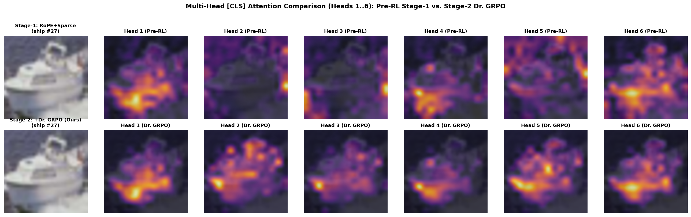
<p align="center">
  <em><b>Direct Multi-Head <code>[CLS]</code> Attention Comparison (Heads 1–6) on <code>ship</code> (#27):</b> While Stage-1 pre-training (top row) suffers from perimeter border reflections and ocean clutter (<b>Border Leakage = 97.9%</b>, <b>FG IoU = 32.9%</b>), 10 epochs of 100% label-free <b>Dr. GRPO</b> alignment (bottom row) systematically purge background noise across all six heads (<b>Border Leakage = 33.4%</b>, <b>FG IoU = 71.7%</b>, a <b>+38.8%</b> leap).</em>
</p>

</div>

---

## ⚡ Why Dr. DINO?

Self-supervised Vision Transformers trained via self-distillation without labels (**DINOv1**, Caron et al., ICCV 2021) exhibit remarkable emergent scene layout decomposition. However, standard ViT formulations suffer from **three fundamental bottlenecks**:
1. **Bicubic Coordinate Warping**: Resizing static learnable Absolute Positional Embeddings (APEs) between global ($224^2$) and local ($96^2$) multi-crop views warps spatial frequencies and breaks translation equivariance.
2. **Quadratic Attention Dilution**: Dense $\mathcal{O}(N^2)$ attention ($197 \times 197 = 38,809$ pairs) disperses probability mass over background distractors (sky, grass, ocean), polluting the global `[CLS]` representation.
3. **Residual Background Halos**: Global cross-entropy distillation aligns view-level `[CLS]` distributions without an explicit patch-level verification mechanism to suppress peripheral background leakage.

**Dr. DINO** (**D**istillation with no labels **R**einforced via **Dr.** GRPO) solves all three challenges with **zero added backbone parameters** and **zero human annotations**:

| Pillar | Core Mechanism | Key Mathematical & Engineering Advantage |
| :--- | :--- | :--- |
| **1. Frequency-Adaptive 2D RoPE** | Continuous 2D axial rotation with spectral ramp $\alpha_m = 1 - \frac{m}{M-1}$ | High frequencies preserve discrete patch lattice steps ($x_{\text{raw}}$); low frequencies maintain scale-invariant global envelopes ($x_{\text{norm}}$). `[CLS]` remains unrotated ($\mathbf{R}=\mathbf{I}$). |
| **2. Spatial-Semantic Sparse Attention ($S^3$)** | Local $3\times 3$ Chebyshev window $\cup$ Dynamic Top-$16$ semantic keys $\cup$ Bidirectional `[CLS]` | Prunes active keys from $197 \to \mathbf{26}$ per query (**-86.8% background pairs**) with exact $-\infty$ masked Softmax normalization and $4\times$ higher peak foreground density. |
| **3. Verifiable RLVR via Dr. GRPO** | Shared-prefix Bernoulli patch policy optimized against 3 deterministic visual verifiers | Unlocks only the top 2 ViT blocks + lightweight gate $g_\phi$ (**8.27% params, < 3 GB VRAM**). Boosts Foreground Mask IoU by **+16.99% to +20.10%** and reaches **99.91% CorLoc** without labels or neural critics. |

---

## 🏗️ System Architecture

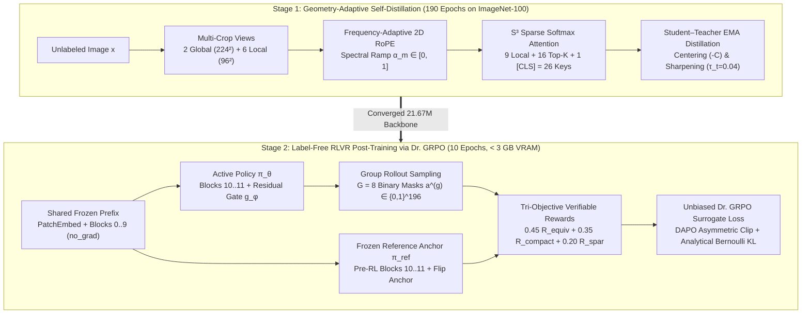

---

## 🔬 Visual Deep Dive: From Mathematical Theory to Empirical Proof

### 1. Stage-1 Innovation I: Frequency-Adaptive 2D RoPE
Instead of static lookup tables, we partition each attention head ($d_k = 64$) into $X$ and $Y$ axes ($d_x = d_y = 32$, $M = 16$ frequency bands $\omega_m = 10000^{-2m/d_x}$) and blend raw vs. scale-normalized coordinates across the frequency spectrum:

$$\alpha_m = 1 - \frac{m}{M - 1} \in [0, 1], \qquad x_m^{\text{adapt}} = \alpha_m \, x_{\text{raw}} + (1 - \alpha_m) \, x_{\text{norm}}, \qquad y_m^{\text{adapt}} = \alpha_m \, y_{\text{raw}} + (1 - \alpha_m) \, y_{\text{norm}}$$

$$\mathcal{K}_{\text{RoPE}}(c, j) = \langle \mathbf{q}_c^{\text{rot}}, \, \mathbf{k}_j^{\text{rot}} \rangle = \sum_{m=0}^{M-1} 2\cos\!\big(\Delta x_m^{\text{adapt}} \omega_m\big) + \sum_{m=0}^{M-1} 2\cos\!\big(\Delta y_m^{\text{adapt}} \omega_m\big)$$

<p align="center">
  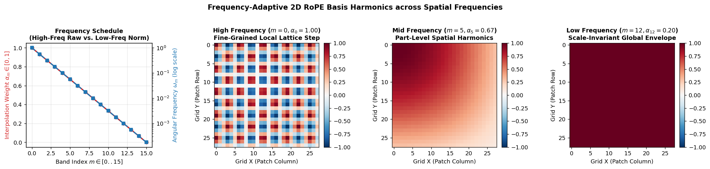
  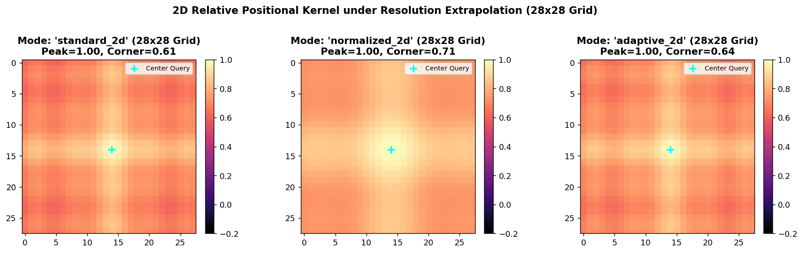
</p>

---

### 2. Stage-1 Innovation II: Spatial-Semantic Sparse Attention ($S^3$)
Every spatial query $i \in \{1, \dots, 196\}$ routes strictly through **26 active keys** (**86.8% reduction**), applying exact $-\infty$ masking prior to Softmax normalization so $\sum_{j \in \mathcal{S}_i} A_{ij} \equiv 1$:

$$\mathcal{S}_i = \underbrace{\mathcal{N}_{\text{local}}(i)}_{3\times 3\text{ window (9)}} \;\cup\; \underbrace{\operatorname{Top-}16_{j \notin \mathcal{N}_{\text{local}}(i)}\!\left(\frac{\langle \mathbf{q}_i^{\text{rot}}, \, \mathbf{k}_j^{\text{rot}} \rangle}{\sqrt{d_k}}\right)}_{\text{Dynamic Semantic Keys (16)}} \;\cup\; \underbrace{\{\text{CLS}\}}_{\text{Global Conduit (1)}}$$

<p align="center">
  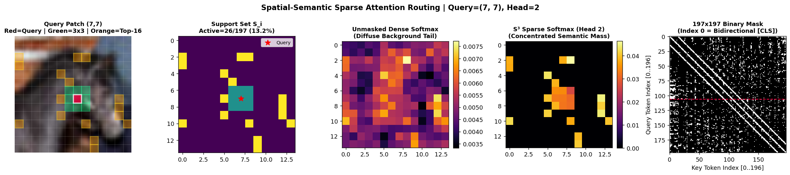
</p>

<details>
<summary><b>🔍 Click to expand: Stage-1 Multi-Head Self-Attention Specialization (Before RLVR)</b></summary>
<br/>
<table align="center">
  <tr>
    <th align="center">Airplane Class (Heads 1–6)</th>
    <th align="center">Horse Class (Heads 1–6)</th>
  </tr>
  <tr>
    <td>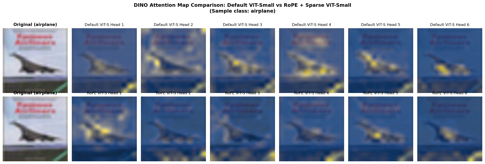</td>
    <td>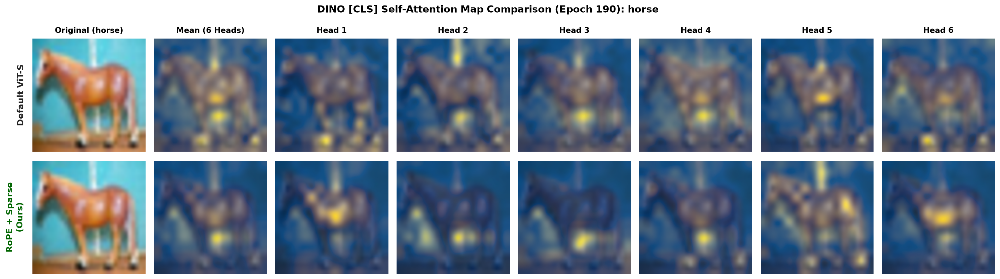</td>
  </tr>
  <tr>
    <td align="center"><em>Vanilla ViT disperses attention into sky clutter.<br/><b>Dr. DINO-Base</b> locks onto fuselage, wings, and tailfin.</em></td>
    <td align="center"><em>Vanilla ViT bleeds into surrounding pasture turf.<br/><b>Dr. DINO-Base</b> delineates dorsal curve, head, and limbs.</em></td>
  </tr>
</table>
</details>

---

### 3. Stage-2 Innovation III: Verifiable RLVR via Unbiased Dr. GRPO

To purge residual border reflections without labels, `DINOGRPOPolicyWrapper` freezes the first 10 ViT blocks (`torch.no_grad()`) and constructs a patch-level Bernoulli policy $\pi_\theta(\mathbf{a}\mid I) = \prod_{p=1}^{196} p_p^{a_p}(1-p_p)^{1-a_p}$ using standardized `[CLS]` attention $\hat{a}_p$, learned residual gate $g_\phi(\mathbf{z}_p)$, TokenCut diffusion prior $\hat{s}_p$, and sparsity bias $b_{\text{sparsity}} = \log(0.35 / 0.65) \approx -0.619$:

$$\ell_p^\theta = 0.55\big(\gamma \hat{a}_p^\theta + b_{\text{sparsity}}\big) + 0.45\big(g_\phi(\mathbf{z}_p) + 1.35\,\hat{s}_p + b_{\text{sparsity}}\big), \qquad p_p^\theta = \sigma(\ell_p^\theta)$$

<p align="center">
  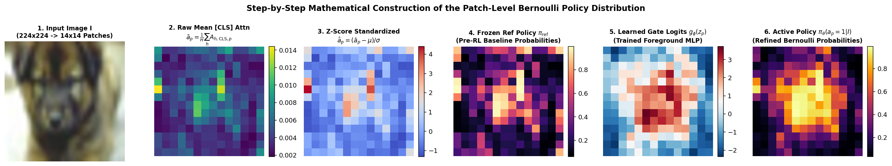
</p>

Each group of $G=8$ sampled binary masks $\{\mathbf{a}^{(1)}, \dots, \mathbf{a}^{(8)}\}$ is evaluated by **three 100% label-free verifiable rewards** ($R = 0.45 R_{\text{equiv}} + 0.35 R_{\text{compact}} + 0.20 R_{\text{sparsity}}$):
1. **Horizontal-Flip Geometric Equivariance IoU ($w_{\text{eq}}=0.45$)**: Binary IoU against the un-flipped Top-35% anchor $\mathbf{m}_{\text{eq}} = \operatorname{Top-}69\big(T^{-1}(\pi_\theta(T(I)))\big)$.
2. **TokenCut Spectral Association & 2D Total Variation ($w_{\text{comp}}=0.35$)**: $0.65 R_{\text{ncut}}(\mathbf{a}^{(g)}) + 0.35 R_{\text{TV}}(\mathbf{a}^{(g)})$ over non-negative patch cosine affinity $W_{pq} = \max(0, \hat{\mathbf{z}}_p^\top \hat{\mathbf{z}}_q)$.
3. **Target Sparsity Ratio Prior ($w_{\text{spar}}=0.20$)**: Peaks sharply at $\rho_{\text{target}} = 35\%$, preventing trivial all-ones or empty masks.

<p align="center">
  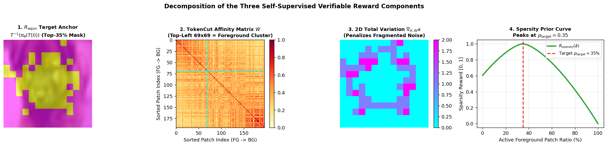
</p>

We optimize the **Length-Normalized Unbiased Dr. GRPO Surrogate Objective** with **DAPO Asymmetric Clip-Higher** ($\epsilon_{\text{low}}=0.20, \epsilon_{\text{high}}=0.28$) and analytical Bernoulli KL regularization ($\beta_{\text{KL}}=0.04$):

$$\rho_i(\theta) = \exp\!\left(\frac{1}{N}\sum_{p=1}^N \log \frac{\pi_\theta(a_{i,p}\mid I)}{\pi_{\theta_{\text{old}}}(a_{i,p}\mid I)} + 0.1\,\Delta \mathcal{C}_{\text{align}}\right), \qquad A_i^{\text{Dr.GRPO}} = R^{(i)} - \frac{1}{G}\sum_{j=1}^G R^{(j)}$$

$$\mathcal{L}_{\text{Dr.GRPO}}(\theta) = -\frac{1}{G}\sum_{i=1}^G \min\!\Big(\rho_i(\theta) A_i^{\text{Dr.GRPO}}, \; \operatorname{clip}\!\big(\rho_i(\theta), \, 1-\epsilon_{\text{low}}, \, 1+\epsilon_{\text{high}}\big) A_i^{\text{Dr.GRPO}}\Big) + \beta_{\text{KL}}\,\mathbb{D}_{\text{KL}}\!\left(\pi_\theta \parallel \pi_{\text{ref}}\right)$$

<p align="center">
  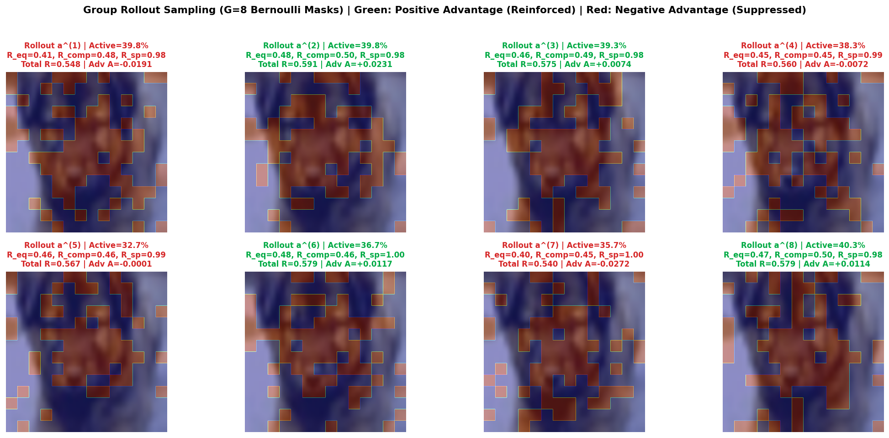
  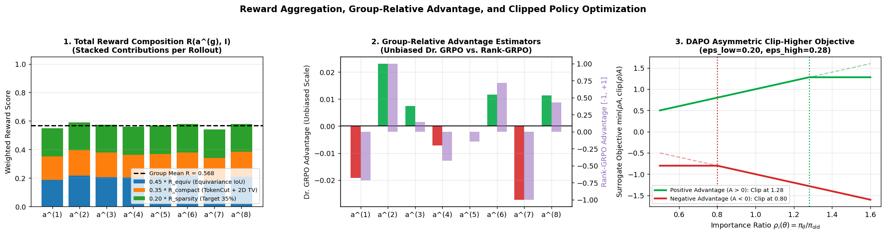
</p>

---

## 📊 Comprehensive Empirical Benchmarks

All models are pre-trained without labels on **ImageNet-100** (190 epochs for Stage-1; 10 epochs for Stage-2 Dr. GRPO) and evaluated on the full **CIFAR-10** benchmark (50,000 train / 10,000 test images).

### 1. End-to-End $2 \times 2$ Factorial Ablation (Architecture $\times$ Verifiable Policy Optimization)

<p align="center">
  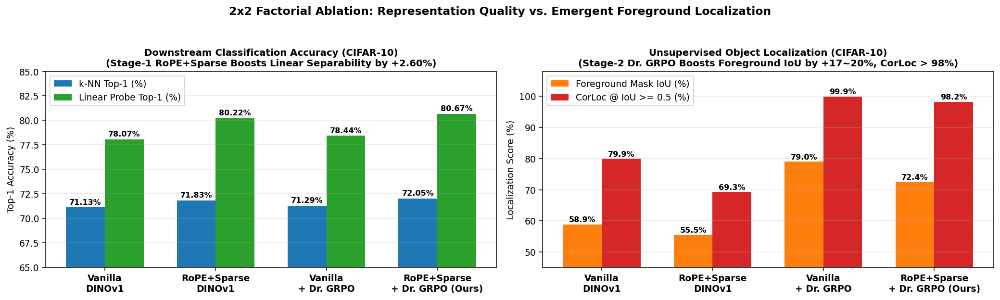
</p>

| Model Variant | Backbone Arch | Dr. GRPO Policy | $k$-NN Top-1 | $k$-NN Top-5 | Linear Probe Top-1 | Foreground Mask IoU | CorLoc ($\ge 0.5$) |
| :--- | :--- | :---: | :---: | :---: | :---: | :---: | :---: |
| **1. Vanilla DINOv1** | `vit_small` | ❌ | 71.13% | 96.57% | 78.07% | 58.88% | 79.93% |
| **2. Dr. DINO-Base** | `vit_small_sparse_rope` | ❌ | 71.83% | 96.98% | 80.22% | 55.45% | 69.26% |
| **3. Vanilla + Dr. GRPO** | `vit_small` | ✅ | 71.29% | 96.73% | 78.44% | **78.98%** | **99.91%** |
| **4. Dr. DINO-Full (Ours)** | `vit_small_sparse_rope` | ✅ | **72.05%** | **97.12%** | **80.67%** | **72.44%** | **98.17%** |
| *Gain: Dr. GRPO on Vanilla (3 vs. 1)* | — | — | **+0.16%** | **+0.16%** | **+0.37%** | **+20.10%** | **+19.98%** |
| *Gain: Dr. GRPO on Dr. DINO (4 vs. 2)* | — | — | **+0.22%** | **+0.14%** | **+0.45%** | **+16.99%** | **+28.91%** |
| *Gain: Full Dr. DINO vs. Baseline (4 vs. 1)* | — | — | **+0.92%** | **+0.55%** | **+2.60%** | **+13.56%** | **+18.24%** |

---

### 2. Visual Showcase: Contiguous Object Masks & Border Leakage Suppression

<p align="center">
  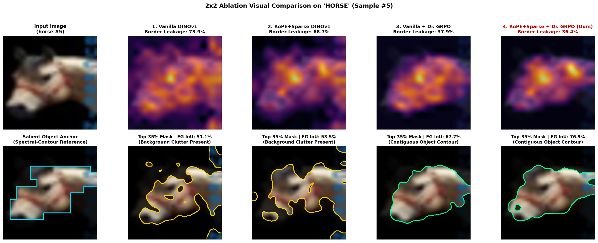
  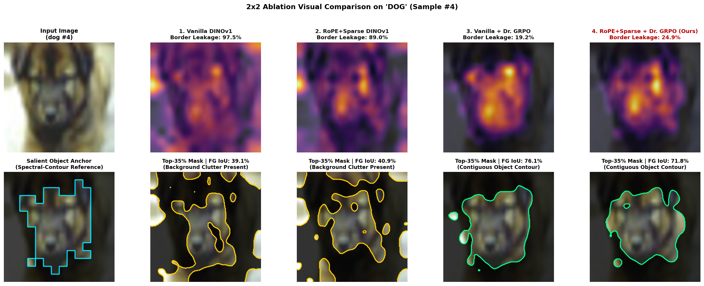
</p>

<details>
<summary><b>🖼️ Click to expand more classes: Airplane (#54), Automobile (#23), and Ship (#27)</b></summary>
<br/>
<p align="center">
  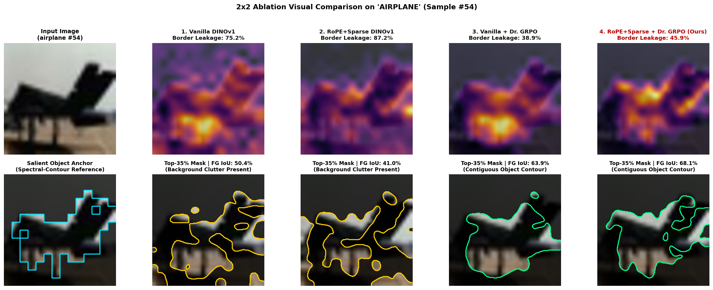
  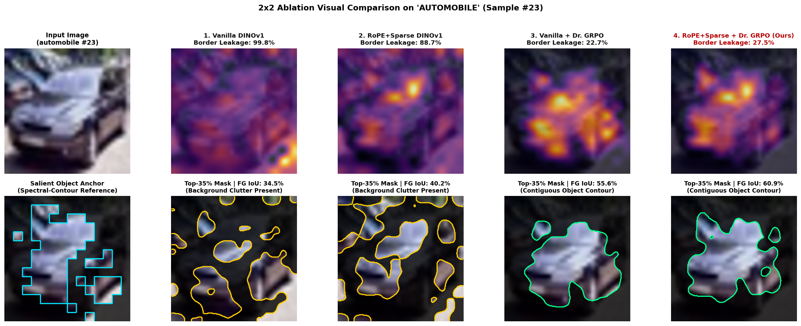
  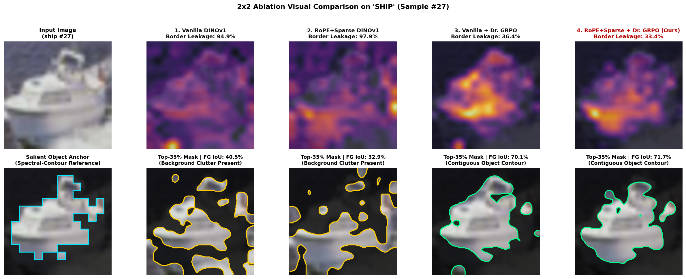
</p>
</details>

---

### 3. Standardized 190-Epoch Downstream Classification & Hardware Profiling

| Evaluation Protocol / Resource Metric | Baseline ViT-Small | Dr. DINO (Ours) | Delta / Architectural Note |
| :--- | :---: | :---: | :--- |
| **$k$-NN Classification Top-1 ($k=10$)** | 74.41% | **75.97%** | **+1.56%** |
| **$k$-NN Classification Top-1 ($k=20$)** | 74.34% | **75.31%** | **+0.97%** |
| **Linear Probing Top-1 (Epoch 10)** | 80.92% | **83.38%** | **+2.46%** *(Beats baseline's 100-epoch peak in 10 epochs!)* |
| **Linear Probing Top-1 (Best Checkpoint)** | 81.46% | **83.98%** | **+2.52%** |
| **Linear Probing Top-5 (Best Checkpoint)** | 99.31% | **99.44%** | **+0.13%** |
| **Backbone Trainable Parameters** | **21,665,664** | **21,665,664** | **0% Overhead (Exact Parity)** |
| **Total Pre-training Parameters (with Head)** | **31,385,728** | **31,385,728** | **Identical (31.39M)** |
| **Theoretical Complexity ($224 \times 224$)** | **9.20 GFLOPs** | **9.20 GFLOPs** | **Exact Parity (4.60 GMACs)** |
| **Active Keys per Spatial Query** | 197 keys | **26 keys** | **-86.8% Sparsity Reduction** |
| **Stage-2 RLVR Peak GPU Memory** | — | **< 3.0 GB** | **Shared-Prefix Wrapper (8.27% trainable)** |

---

## 🧪 Interactive Research Notebooks

Explore every equation, intermediate tensor, and empirical chart step-by-step via our self-contained Jupyter notebooks in [`notebooks/`](notebooks/):

| Notebook | Focus Area & Interactive Visuals |
| :--- | :--- |
| 📓 [**`demo_01_stage1_rope_and_sparse_attention.ipynb`**](notebooks/demo_01_stage1_rope_and_sparse_attention.ipynb) | **Stage-1 Architectural Mechanics**: Spectral ramp $\alpha_m$, 2D basis harmonics across frequencies, $14^2 \to 28^2$ resolution extrapolation kernels, and patch-level $S^3$ routing breakdown ($3\times 3$ local + Top-$16$ semantic + `[CLS]`). |
| 📓 [**`demo_02_stage2_policy_rewards_and_dr_grpo.ipynb`**](notebooks/demo_02_stage2_policy_rewards_and_dr_grpo.ipynb) | **Stage-2 RLVR & Dr. GRPO Deep Dive**: 6-step Bernoulli policy construction, 4-panel decomposition of `self_supervised_v1` rewards, $G=8$ group rollout sampling, Unbiased vs. Rank-GRPO advantages, and DAPO Clip-Higher curves. |
| 📓 [**`demo_03_end_to_end_2x2_ablation_showcase.ipynb`**](notebooks/demo_03_end_to_end_2x2_ablation_showcase.ipynb) | **End-to-End $2 \times 2$ Ablation Showcase**: Quantitative classification vs. localization charts, perimeter Border Leakage (%) analysis, Top-35% contiguous object contours across 5 classes, and 6-head Pre-RL vs. Post-RL comparisons. |
| 📓 [**`colab_grpo_master_pipeline.ipynb`**](notebooks/colab_grpo_master_pipeline.ipynb) | **End-to-End Cloud Execution Pipeline**: Full training and evaluation workflow ready for single-GPU execution on Google Colab / Kaggle / Workstation GPUs. |

---

## 📂 Repository Architecture

```text
DINOv1/
├── configs/                   # Declarative YAML experiment configurations
│   ├── dry_run.yaml               # Rapid 2-epoch verification with synthetic fallback
│   ├── vit_small_modular.yaml     # Baseline ViT-Small/16 modular configuration
│   ├── vit_small_200k.yaml        # Extended schedule ViT-Small configuration
│   └── vit_small_sparse_rope.yaml # Dr. DINO-Base (2D RoPE + S³ Sparse Attention)
├── core/                      # Industrial Registry & Declarative Builder engine
│   ├── registry.py                # Decorator-driven component registry (@REGISTRY.register)
│   └── builder.py                 # Factory methods: build_model, build_loss, build_optimizer
├── dino_datasets/             # Multi-crop data pipelines & dataset downloaders
│   ├── transforms.py              # DataAugmentationDINO (2 global 224² + 6 local 96² views)
│   └── prepare_subset.py          # Automated ImageNet-100 HuggingFace Hub downloader
├── eval/                      # Standardized downstream evaluation & visualization suite
│   ├── eval_utils.py              # Unified checkpoint loader and dataloader factory
│   ├── eval_knn.py                # Weighted k-NN classifier (k ∈ {10, 20, 200}, T=0.07)
│   ├── eval_linear.py             # Linear Probing classifier with fast feature caching
│   ├── eval_ablation_2x2.py       # Complete 2x2 factorial benchmark (k-NN, Linear, IoU, CorLoc)
│   └── visualize_attention.py     # Multi-head [CLS] self-attention map renderer
├── losses/                    # Self-supervised & RLVR objective functions
│   ├── dino_loss.py               # DINOLoss with EMA Centering and Teacher Sharpening
│   └── dr_grpo_loss.py            # DrGRPOLoss with verifiable visual rewards & DAPO clipping
├── models/                    # Neural network backbones & policy wrappers
│   ├── vision_transformer.py      # Modular VisionTransformer (vit_tiny, vit_small, sparse_rope)
│   ├── rope.py                    # FrequencyAdaptive2DRoPE (adaptive_2d, standard_2d, norm_2d)
│   ├── sparse_attention.py        # SpatialSemanticAttention (S³) & MultiScale2DWindowAttention
│   ├── dino_head.py               # DINOHead (3-layer MLP + L2 bottleneck + WeightNorm prototypes)
│   ├── multi_crop_wrapper.py      # Resolution-grouped batched multi-crop forward wrapper
│   └── grpo_policy_wrapper.py     # DINOGRPOPolicyWrapper (Shared-Prefix Stage-2 RLVR policy)
├── notebooks/                 # Interactive mathematical & visual research notebooks
├── output/                    # High-resolution empirical plots, masks, and benchmark JSONs
├── papers/                    # LaTeX source & compiled 18-page paper (dr_dino.pdf)
├── slides/                    # LaTeX Beamer source & compiled 22-slide deck (defense_presentation.pdf)
├── tests/                     # Automated pytest suite verifying RoPE, S³, Builder, and Dr. GRPO
├── utils/                     # Schedulers, TokenCut spectral saliency, and logging utilities
├── train.py                   # Stage-1 self-supervised DINO pre-training entry point
└── train_grpo_post.py         # Stage-2 label-free Dr. GRPO policy optimization entry point
```

---

## 🚀 Quick Start & Reproduction

### 1. Installation

```bash
# Clone the repository
git clone https://github.com/nhanvu10092001/DINOv1.git
cd DINOv1

# Install dependencies and register package in editable mode
pip install -r requirements.txt
pip install -e .

# Verify installation with the automated unit test suite
pytest tests -v
```

### 2. Dataset Preparation

```bash
# Download ImageNet-100 from Hugging Face Hub for self-supervised pre-training
python dino_datasets/prepare_subset.py --dataset clane9/imagenet-100 --output_dir data

# Download CIFAR-10 for downstream transfer & localization evaluation
python utils/download_cifar10.py
```

### 3. Stage-1 Self-Supervised Pre-Training (2D RoPE + $S^3$ Sparse Attention)

```bash
# Quick 2-epoch dry-run sanity check
python train.py --config configs/dry_run.yaml

# Train Dr. DINO-Base (ViT-Small/16 with Frequency-Adaptive 2D RoPE & S³ Attention)
python train.py --config configs/vit_small_sparse_rope.yaml

# Or train Baseline Vanilla DINOv1 (ViT-Small/16)
python train.py --config configs/vit_small_modular.yaml
```

### 4. Stage-2 Verifiable RLVR Post-Training (Dr. GRPO)

```bash
# Run 10-epoch label-free Dr. GRPO optimization (< 3 GB VRAM)
python train_grpo_post.py \
    --train_data_path data/train \
    --eval_data_path data/cifar10 \
    --eval_dataset cifar10 \
    --variant both \
    --epochs 10 \
    --batch_size 64 \
    --group_size 8 \
    --adv_type dr_grpo \
    --reward_mode self_supervised_v1
```

### 5. Downstream Evaluation & $2 \times 2$ Ablation Suite

```bash
# 1. Run the complete 2x2 Factorial Benchmark (k-NN, Linear Probe, Mask IoU, CorLoc)
python eval/eval_ablation_2x2.py \
    --data_path data/cifar10 \
    --dataset cifar10 \
    --batch_size 128 \
    --max_train_samples 0 \
    --max_val_samples 0

# 2. Standalone k-NN Evaluation (k=10 or k=20)
python eval/eval_knn.py \
    --data_path data/cifar10 \
    --dataset cifar10 \
    --pretrained_weights cp/checkpoints_rope_2/checkpoint0190.pth \
    --arch vit_small_sparse_rope \
    --k 10

# 3. Standalone Linear Probing Evaluation with Feature Caching
python eval/eval_linear.py \
    --data_path data/cifar10 \
    --dataset cifar10 \
    --pretrained_weights cp/checkpoints_rope_2/checkpoint0190.pth \
    --arch vit_small_sparse_rope \
    --epochs 100 \
    --lr 0.1 \
    --cache_features
```

---

## 📖 Citation

If you find **Dr. DINO**, our **Frequency-Adaptive 2D RoPE**, **Spatial-Semantic Sparse Attention ($S^3$)**, or **Verifiable Visual Dr. GRPO** useful in your research or engineering projects, please consider starring ⭐ this repository and citing our work:

```bibtex
@article{vu2026drdino,
  title   = {Verification Is All You Need: Emergent Object Discovery in Self-Supervised Vision Transformers via Dr. GRPO},
  author  = {Vu, Pham Cung Le Nhan and Khang, Nguyen Hoang and Nam, Nguyen Hoai},
  journal = {arXiv preprint},
  year    = {2026}
}
```

---

## 📄 License

This project is licensed under the [**Apache License 2.0**](LICENSE).
