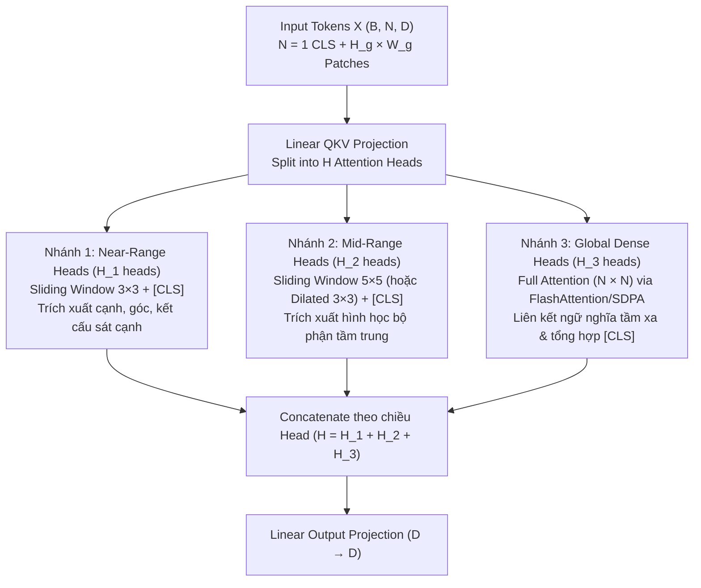

# Đề xuất & Giả thuyết Nghiên cứu: Cơ chế Multi-Scale Hybrid Head Attention (MS-HHA) cho Học Tự Giám Sát DINO

**Chủ đề:** Tối ưu hóa cơ chế Self-Attention trong Vision Transformer (DINOv1) thông qua phân tách trường nhìn đa tỉ lệ theo Head (Multi-Scale Receptive Field per Head).

---

## 1. Đặt vấn đề & Động lực nghiên cứu (Motivation)

### 1.1. Hạn chế của Full Self-Attention truyền thống trong DINO
Trong kiến trúc Vision Transformer (ViT) tiêu chuẩn được sử dụng bởi DINO, tất cả $H$ Attention Heads tại mỗi tầng đều thực hiện phép tính **Full Dense Attention** với độ phức tạp bậc hai $\mathcal{O}(N^2)$ theo số lượng token $N = H_g \times W_g + 1$:

$$\text{Attention}(Q, K, V) = \text{Softmax}\left(\frac{QK^T}{\sqrt{d_k}}\right)V, \quad Q, K, V \in \mathbb{R}^{B \times H \times N \times d_k}$$

Cách tiếp cận đồng nhất này tồn tại hai nhược điểm lớn:
1. **Sự dư thừa tính toán ở các Head cục bộ (Redundant Computation)**: Các nghiên cứu phân tích hành vi của ViT và DINO chỉ ra rằng sau khi hội tụ, một tỷ lệ lớn các Attention Heads tự động thu hẹp phạm vi chú ý về vùng không gian lân cận ngay sát patch truy vấn (chỉ tập trung vào khoảng cách 1–2 patch xung quanh để trích xuất biên, góc và kết cấu bề mặt). Việc buộc các head này phải tính tích vô hướng $QK^T$ và hàm mũ $\exp(\cdot)$ với toàn bộ các patch ở xa (nơi trọng số sau Softmax xấp xỉ $0$) gây lãng phí từ **80% – 95% khối lượng tính toán**.
2. **Thiếu thiên kiến quy nạp đa tỉ lệ (Lack of Multi-Scale Inductive Bias)**: Vì mọi head đều khởi đầu với trường nhìn phẳng toàn cục, mô hình không có sẵn cấu trúc phân cấp không gian (gần – trung bình – xa) mà phải tốn nhiều chu kỳ huấn luyện để tự hình thành tính cục bộ từ dữ liệu.

### 1.2. Hạn chế của phương pháp Sparse Masking (`-inf`) + Top-$K$
Trong phiên bản thử nghiệm `SpatialSemanticAttention` hiện tại, việc giới hạn vùng chú ý được thực hiện bằng cách:
1. Nhân toàn bộ ma trận tương đồng đầy đủ $S = QK^T \in \mathbb{R}^{B \times H \times N \times N}$.
2. Tìm `torch.topk` trên toàn ma trận để lấy các token ngữ nghĩa.
3. Gán $-\infty$ (`masked_fill(-inf)`) vào các vị trí không được chọn trước khi đưa qua `Softmax` và nhân với $V$.

**Vấn đề cốt lõi:** Mặc dù ma trận sau Softmax có tính thưa (sparse) về mặt toán học (~87% phần tử bằng $0$), phương pháp này **không giúp giảm thời gian suy diễn (Inference Time)** mà thực tế còn làm chậm mô hình do:
- Vẫn phải thực hiện 100% phép nhân $QK^T$ và $AV$ ở kích thước đầy đủ $(N \times N)$ (trong đó 87% phép nhân ở bước sau là phép nhân vô nghĩa $0 \times V_j$).
- Phát sinh chi phí phụ (overhead) rất lớn khi gọi `torch.topk` và cấp phát bộ nhớ cho các mặt nạ boolean $(B, H, N, N)$ tại tất cả các tầng.

---

## 2. Nguyên lý Trường nhìn Đa tỉ lệ (Multi-Scale Receptive Field)

Trong thị giác máy tính hiện đại, các kiến trúc trích xuất đặc trưng đa nhánh (Multi-Branch / Multi-Kernel Convolution) luôn duy trì một nguyên lý thiết kế cốt lõi:

> **Nguyên lý Đa tỉ lệ (Multi-Scale Receptive Field Principle):** Để biểu diễn trọn vẹn một bức ảnh, mạng nơ-ron cần trích xuất **đồng thời** các đặc trưng ở nhiều phạm vi không gian khác nhau trên các nhánh song song, sau đó tổng hợp (Concatenate + Projection) lại:
> - **Nhánh Kernel nhỏ ($3 \times 3$)**: Thu nhận thông tin cục bộ tầm gần (cạnh sắc, chi tiết hạt, ranh giới mảnh).
> - **Nhánh Kernel trung bình ($5 \times 5, 7 \times 7$)**: Thu nhận cấu trúc hình học tầm trung (các bộ phận cấu thành vật thể như mắt, tai, bánh xe).
> - **Nhánh Trường nhìn rộng / Toàn cục (Large Kernel / Global Pooling / Area-Global Attention)**: Nắm bắt mối tương quan ngữ nghĩa tầm xa giữa các vật thể hoặc các phần xa nhau của cùng một đối tượng.

Khi ánh xạ nguyên lý này sang cơ chế **Multi-Head Self-Attention (MHSA)** của Vision Transformer, ta nhận thấy: **Mỗi nhóm Attention Head hoàn toàn có thể đóng vai trò như một nhánh Kernel có kích thước vùng nhìn (Window Size) khác nhau!**

---

## 3. Giả thuyết Nghiên cứu (Research Hypothesis)

### Phát biểu Giả thuyết
> **Giả thuyết:** *Trong mô hình tự giám sát DINO, việc thay thế cơ chế Attention đồng nhất bằng kiến trúc **Multi-Scale Hybrid Head Attention (MS-HHA)** — trong đó các Attention Heads trong cùng một tầng được phân chia tường minh thành các nhóm **Sliding-Window Heads đa kích thước** (ví dụ $3 \times 3$ cho tầm gần, $5 \times 5$ hoặc $7 \times 7$ cho tầm trung) kết hợp với một nhóm nhỏ **Dense Global Heads** ($N \times N$ cho ngữ cảnh toàn cục) — sẽ đạt được đồng thời hai mục tiêu:*
> 1. **Về chất lượng biểu diễn (Accuracy & Semantics):** Bảo toàn hoặc cải thiện chất lượng đặc trưng tự giám sát so với Full Attention nhờ tiêm trực tiếp thiên kiến quy nạp đa tỉ lệ (Multi-Scale Inductive Bias), giúp mô hình nắm bắt đồng thời chi tiết biên cục bộ lẫn ngữ nghĩa toàn cục mà không cần dùng đến phép lọc `Top-K` đắt đỏ.
> 2. **Về hiệu năng tính toán (Inference Efficiency):** Vì vùng lân cận của các Sliding-Window Heads được xác định cố định về mặt hình học (trích xuất trực tiếp qua phép trượt cửa sổ `unfold`), mô hình **loại bỏ hoàn toàn việc tính toán trên các vùng $-\infty$ cũng như loại bỏ hoàn toàn bước tìm `Top-K`**, giảm độ phức tạp tại các head cục bộ từ $\mathcal{O}(N^2)$ xuống $\mathcal{O}(N \cdot k^2)$ và tăng tốc độ thực thi thực tế.

---

## 4. Thiết kế Kiến trúc Đề xuất (Proposed Architecture)

### 4.1. Sơ đồ phân chia Head đa tỉ lệ (Ví dụ trên `ViT-Small` với $H = 6$ Heads, ảnh $224 \times 224 \Rightarrow N = 197$)

Tại mỗi khối Transformer Block, sau khi chiếu tuyến tính đầu vào $X \in \mathbb{R}^{B \times N \times D}$ thành $Q, K, V \in \mathbb{R}^{B \times H \times N \times d_k}$, ta chia $H$ heads thành các nhóm chuyên biệt chạy song song:

### 4.2. Cơ chế toán học ở từng nhánh (Không dùng Mask $-\infty$)

#### Nhánh 1 & Nhánh 2: Multi-Scale Sliding Window Attention ($k \in \{3, 5\}$)
Thay vì nhân $Q_{\text{patch}} \in \mathbb{R}^{N_p \times d_k}$ với toàn bộ $K \in \mathbb{R}^{N \times d_k}$ rồi gán $-\infty$, ta định hình lại (reshape) các patch token $K_{\text{patch}}, V_{\text{patch}}$ về không gian 2D $(H_g \times W_g)$ và dùng toán tử trượt cửa sổ $\text{Unfold}(k \times k)$:
- Với mỗi patch thứ $i \in \{1, \dots, N_p\}$, ta chỉ trích xuất đúng $k^2$ khóa lân cận không gian $\mathcal{N}_k(i)$ cùng với khóa của token $[CLS]$:
  $$K_{\text{win}}(i) = \left[ K_{\text{CLS}} \;\Vert\; \{K_j\}_{j \in \mathcal{N}_k(i)} \right] \in \mathbb{R}^{(1 + k^2) \times d_k}$$
- Tích vô hướng và Softmax **chỉ tính trên đúng $(1 + k^2)$ phần tử thực sự có kết nối**:
  $$A_{\text{local}}(i) = \text{Softmax}\left(\frac{Q_i \cdot K_{\text{win}}(i)^T}{\sqrt{d_k}}\right) \in \mathbb{R}^{1 \times (1 + k^2)}$$
  $$Y_{\text{local}}(i) = A_{\text{local}}(i) \cdot V_{\text{win}}(i)$$
- **Xử lý biên không cần $-\infty$:** Sử dụng đệm lặp biên (`replicate` hoặc `reflect` padding) trước khi `unfold` giúp mọi patch ở rìa ảnh luôn có đủ $k^2$ phần tử hợp lệ, không sinh ra bất kỳ ô đệm $-\infty$ nào.

#### Nhánh 3: Global Dense Attention ($H_{\text{dense}}$ heads)
- Đảm nhận vai trò thay thế cho bước `Top-K Semantic` của thiết kế cũ nhưng **không tốn chi phí tìm kiếm `topk`**.
- Chạy trực tiếp phép tính Dense Attention chuẩn thông qua nhân tối ưu phần cứng (`F.scaled_dot_product_attention` / FlashAttention):
  $$Y_{\text{global}} = \text{SDPA}(Q_{\text{global}}, K_{\text{global}}, V_{\text{global}})$$
- Đảm bảo ở mọi tầng sâu của mạng, các bộ phận nằm xa nhau của vật thể (ví dụ: đầu và đuôi của đối tượng, hoặc giữa 2 vùng Global Crop / Local Crop trong DINO) luôn có đường truyền gradient trực tiếp.

---

## 5. Sự cộng hưởng giữa Multi-Scale Heads và Frequency-Adaptive 2D RoPE

Kiến trúc đề xuất kết hợp hoàn hảo với mô-đun **Frequency-Adaptive 2D RoPE** sẵn có trong dự án:
1. **Ở các Sliding-Window Heads ($3 \times 3, 5 \times 5$)**: Khoảng cách tương đối giữa truy vấn $Q_i$ và khóa $K_j$ trong cửa sổ chỉ dao động trong phạm vi $\Delta x, \Delta y \in [-2, +2]$. Các thành phần tần số cao (high-frequency bands với $\alpha_k \approx 1$, giữ tọa độ lưới tuyệt đối) của 2D RoPE phát huy tối đa tác dụng phân biệt vị trí chính xác giữa các patch liền kề.
2. **Ở các Global Dense Heads ($N \times N$)**: Khoảng cách giữa các patch trải rộng toàn ảnh và thay đổi khi DINO huấn luyện Multi-Crop ($224 \times 224$ so với $96 \times 96$). Các thành phần tần số thấp (low-frequency bands với $\alpha_k \approx 0$, tọa độ chuẩn hóa) giúp các Global Heads duy trì sự ổn định hình học xuyên qua các độ phân giải khác nhau.

---

## 6. Phân tích Độ phức tạp & Lợi ích Tính toán (Complexity Analysis)

Xét cấu hình `ViT-Small` ($H = 6$ heads) trên ảnh đầu vào chuẩn $224 \times 224$ ($N_p = 14 \times 14 = 196$ patches, tổng $N = 197$ tokens):

| Phương pháp | Cấu hình mỗi tầng (6 Heads) | Số cặp tương tác $(Q_i, K_j)$ tính Softmax trên 6 Heads | Chi phí phụ (`topk`, tạo mask, gán `-inf`) |
| :--- | :--- | :--- | :--- |
| **1. DINOv1 Chuẩn (Full Dense)** | 6 Heads Full $(197 \times 197)$ | $6 \times 38,809 = \mathbf{232,854}$ cặp | Không có |
| **2. Sparse Masking hiện tại (`sparse_attention.py`)** | 6 Heads tính $(197 \times 197)$ rồi che $-\infty$ giữ $(9 + 16 + 1)$ | Tính $232,854$ cặp $QK^T$, chạy Softmax trên $232,854$ ô (87% là $-\infty$) | **Rất cao** (`torch.topk` + 2 lần `masked_fill` + `scatter_` mỗi tầng) |
| **3. Đề xuất A (2 nhóm: 3 Local $3\times3$ + 3 Dense)** | 3 Heads Window $3\times3$ ($10$ keys) + 3 Heads Dense ($197$ keys) | $3 \times (196 \times 10 + 197) + 3 \times 38,809$ $= \mathbf{122,898}$ cặp (**Giảm 47.2%**) | **Bằng 0** (Không `topk`, không $-\infty$) |
| **4. Đề xuất B (Đa tỉ lệ: 2 Head $3\times3$ + 2 Head $5\times5$ + 2 Head Dense)** | 2 Heads Window $3\times3$ ($10$ keys) + 2 Heads Window $5\times5$ ($26$ keys) + 2 Heads Dense ($197$ keys) | $2 \times 2,157 + 2 \times 5,293 + 2 \times 38,809$ $= \mathbf{92,518}$ cặp (**Giảm 60.3%**) | **Bằng 0** (Không `topk`, không $-\infty$) |

> **Lưu ý khi mở rộng lên ảnh độ phân giải cao** (ví dụ $512 \times 512 \Rightarrow N = 1025$ tokens):
> - Full Attention phải tính $1025^2 \approx \mathbf{1,050,625}$ cặp/head.
> - Head cửa sổ $3 \times 3$ chỉ tính $1024 \times 10 \approx \mathbf{10,240}$ cặp/head (**nhẹ hơn 102 lần!**).

---

## 7. Kế hoạch Thực nghiệm Kiểm chứng (Ablation Study Plan)

Để chứng minh giả thuyết một cách thuyết phục trong báo cáo/luận văn, có thể thiết kế bảng thực nghiệm đối chứng (Ablation Study) trên cùng một tập dữ liệu (ví dụ CIFAR-10 / CIFAR-100 / ImageNet Subset) với cùng số epoch:

1. **Baseline 1 (`vit_small` chuẩn)**: 6/6 Heads dùng Full Attention + Learned Absolute PosEmbed.
2. **Baseline 2 (`vit_small_sparse_rope` cũ)**: 6/6 Heads dùng Masking $-\infty$ (Local $3\times3$ + Top-$K$ Semantic) + 2D RoPE.
3. **Proposed Variant 1 (2-Scale Hybrid)**: 3 Heads Sliding Window $3\times3$ + 3 Heads Dense + 2D RoPE.
4. **Proposed Variant 2 (3-Scale Hybrid)**: 2 Heads Sliding Window $3\times3$ (Near) + 2 Heads Sliding Window $5\times5$ (Mid) + 2 Heads Dense (Global) + 2D RoPE.

**Các chỉ số đo lường (Evaluation Metrics):**
- **Chất lượng biểu diễn:** Độ chính xác phân loại **k-NN ($k=20$)** và **Linear Probing** (Top-1 / Top-5 Accuracy).
- **Hiệu năng hệ thống:** Thời gian suy diễn trung bình mỗi ảnh (**Inference Latency - ms/image**), thông lượng huấn luyện (**Throughput - images/sec**), và mức tiêu thụ bộ nhớ đỉnh (**Peak VRAM - MB**).
- **Định tính (Qualitative):** Trực quan hóa bản đồ chú ý (Attention Map) của từng nhóm Head ($3\times3$ vs $5\times5$ vs Dense) bằng script `eval/visualize_attention.py` để chứng minh sự phân hóa vai trò rõ rệt giữa các nhánh.
