# 📈 Comprehensive Empirical & Mathematical Benchmark Report: Dr. DINO

<p align="left">
  <a href="papers/dr_dino.pdf"></a>
  <a href="slides/defense_presentation.pdf"></a>
  <a href="notebooks/demo_03_end_to_end_2x2_ablation_showcase.ipynb"></a>
</p>

This technical report provides an end-to-end mathematical and empirical evaluation of **Dr. DINO** (**D**istillation with no labels **R**einforced via **Dr.** GRPO) against baseline **DINOv1** (*Emerging Properties in Self-Supervised Vision Transformers* — Caron et al., ICCV 2021). All models are pre-trained without supervision on **ImageNet-100** (`clane9/imagenet-100`) and evaluated downstream on the complete **CIFAR-10** benchmark (50,000 train / 10,000 test images):

1. **Variant 1 — Vanilla DINOv1 (`vit_small`)**: Canonical ViT-Small/16 with static learnable Absolute Positional Embeddings (APEs) and dense $197 \times 197$ self-attention.
2. **Variant 2 — Dr. DINO-Base (`vit_small_sparse_rope`)**: Stage-1 ViT-Small/16 integrating **Frequency-Adaptive 2D Rotary Position Embeddings (2D RoPE)** and **Spatial-Semantic Sparse Softmax Attention ($S^3$)**.
3. **Variant 3 — Vanilla + Dr. GRPO**: Vanilla DINOv1 aligned via 10 epochs of Stage-2 **Unsupervised Reinforcement Learning with Verifiable Rewards (Dr. GRPO)**.
4. **Variant 4 — Dr. DINO-Full (`vit_small_sparse_rope` + Dr. GRPO)**: Our complete framework combining continuous 2D relative geometry, structured $S^3$ sparsity, and label-free Dr. GRPO alignment.

---

## 1. Architectural Specifications & Checkpoint Matrix

| Parameter / Attribute | Baseline ViT-Small (`vit_small`) | Dr. DINO Backbone (`vit_small_sparse_rope`) |
| :--- | :--- | :--- |
| **Stage-1 Pretrained Checkpoint** | `cp/checkpoints_default_2/checkpoint0190.pth` | `cp/checkpoints_rope_2/checkpoint0190.pth` |
| **Stage-2 Dr. GRPO Checkpoint** | `cp/grpo_production/default_grpo_best.pth` | `cp/grpo_production/rope_grpo_best.pth` |
| **Pre-Training Dataset** | ImageNet-100 (~130,000 unlabeled images) | ImageNet-100 (~130,000 unlabeled images) |
| **Stage-1 Training Schedule** | 190 epochs on NVIDIA H100 GPU (BS=128) | 190 epochs on NVIDIA H100 GPU (BS=128) |
| **Stage-2 RLVR Schedule** | 10 epochs on 5,000 unlabeled ImageNet-100 images | 10 epochs on 5,000 unlabeled ImageNet-100 images |
| **Patch Grid & Depth** | $16 \times 16$ patches ($14 \times 14$ grid), $L = 12$ blocks | $16 \times 16$ patches ($14 \times 14$ grid), $L = 12$ blocks |
| **Embedding & Head Dimensions** | $D = 384$, $H = 6$ heads ($d_k = 64$ / head) | $D = 384$, $H = 6$ heads ($d_x = 32, d_y = 32$ / head) |
| **Positional Encoding** | Static 1D/2D APE table (bicubic interpolation) | Frequency-Adaptive 2D RoPE (`adaptive_2d`, $M=16$ bands) |
| **Self-Attention Operator** | Dense Softmax ($197 \times 197 = 38,809$ pairs) | $S^3$ Sparse Softmax ($3\times 3$ local + Top-$16$ + `[CLS]` = 26 keys) |
| **DINO Projection Head** | 3-layer MLP ($384 \to 2048 \to 256 \to 16384$) | 3-layer MLP ($384 \to 2048 \to 256 \to 16384$) |

---

## 2. Parameter Complexity & Hardware Profiling

*Measured on an **NVIDIA GeForce RTX 3070 (8 GB VRAM)** at $224 \times 224$ input resolution:*

| Component / Resource Metric | Baseline ViT-Small | Dr. DINO (Ours) | Engineering & Architectural Note |
| :--- | :---: | :---: | :--- |
| **Backbone Trainable Parameters** | **21,665,664** | **21,665,664** | **0% Parameter Overhead (Exact Parity)** |
| **Non-trainable Buffers** | 0 | 32 elements | Precomputed inverse frequencies (`rope.inv_freq`) |
| **DINO Projection Head Parameters** | 9,720,064 | 9,720,064 | Identical MLP + WeightNorm prototype layer |
| **Total Pretraining Parameters** | **31,385,728** | **31,385,728** | **31.39M (Identical)** |
| **Backbone Theoretical FLOPs** | **9.20 GFLOPs** | **9.20 GFLOPs** | **Exact Parity (4.60 GMACs via `FlopCounterMode`)** |
| **Active Keys per Spatial Query** | 197 keys | **26 keys** | **-86.8% Sparsity Reduction (13.2% active density)** |
| **Stage-2 Trainable Policy Params** | 3,587,521 | 3,587,521 | **8.27% of 43.37M wrapper (`blocks[10..11]` + `policy_gate`)** |
| **Stage-2 Peak Training VRAM** | **< 3.0 GB** | **< 3.0 GB** | Shared frozen prefix `blocks[0..9]` under `torch.no_grad()` |
| **Single-Image Latency (BS=1)** | 1.20 ms | 2.20 ms | +1.00 ms from un-fused PyTorch RoPE & Top-$K$ indexing |

---

## 3. Mathematical & Empirical Analysis of Stage-1 Innovations

### 3.1. Frequency-Adaptive 2D RoPE (`models/rope.py`)
For each head ($d_k = 64$), we split channels into horizontal ($d_x = 32$) and vertical ($d_y = 32$) subspaces ($M = 16$ rotation planes per axis with $\omega_m = 10000^{-2m/d_x}$). To simultaneously preserve sharp local edges and multi-crop scale invariance, we blend raw coordinates $x_{\text{raw}}$ and normalized coordinates $x_{\text{norm}} = x_{\text{raw}}(S_{\text{ref}}/W_g)$ via a spectral ramp $\alpha_m$:

$$\alpha_m = 1 - \frac{m}{M - 1} \in [0, 1], \qquad x_m^{\text{adapt}} = \alpha_m \, x_{\text{raw}} + (1 - \alpha_m) \, x_{\text{norm}}, \qquad y_m^{\text{adapt}} = \alpha_m \, y_{\text{raw}} + (1 - \alpha_m) \, y_{\text{norm}}$$

For uniform carrier vectors ($\mathbf{q}_c = \mathbf{k}_j = \mathbf{1}$), the exact 2D relative positional decay kernel takes the closed harmonic form:

$$\mathcal{K}_{\text{RoPE}}(c, j) = \langle \mathbf{q}_c^{\text{rot}}, \, \mathbf{k}_j^{\text{rot}} \rangle = \sum_{m=0}^{M-1} 2\cos\!\big(\Delta x_m^{\text{adapt}} \omega_m\big) + \sum_{m=0}^{M-1} 2\cos\!\big(\Delta y_m^{\text{adapt}} \omega_m\big)$$

<p align="center">
  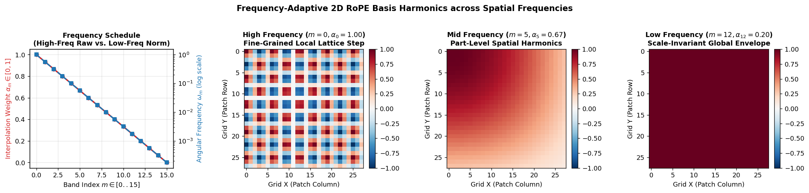
  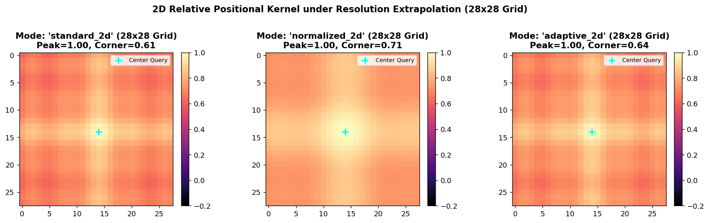
</p>

### 3.2. Spatial-Semantic Sparse Attention ($S^3$, `models/sparse_attention.py`)
Each spatial patch query $i \in \{1, \dots, 196\}$ attends strictly to a composite support set $\mathcal{S}_i$ of **26 active keys** (9 local Chebyshev neighbors $\mathcal{N}_{\text{local}}(i)$ + 16 dynamic semantic Top-$K$ tokens $\mathcal{N}_{\text{semantic}}(i)$ + 1 global `[CLS]` conduit), normalized via exact $-\infty$ masking prior to Softmax:

$$\mathcal{S}_i = \mathcal{N}_{\text{local}}(i) \;\cup\; \operatorname{Top-}16_{j \notin \mathcal{N}_{\text{local}}(i)}\!\left(\frac{\langle \mathbf{q}_i^{\text{rot}}, \, \mathbf{k}_j^{\text{rot}} \rangle}{\sqrt{d_k}}\right) \;\cup\; \{\text{CLS}\}, \qquad A_{ij} = \frac{\exp(\tilde{s}_{ij})}{\sum_{l \in \mathcal{S}_i} \exp(\tilde{s}_{il})}$$

<p align="center">
  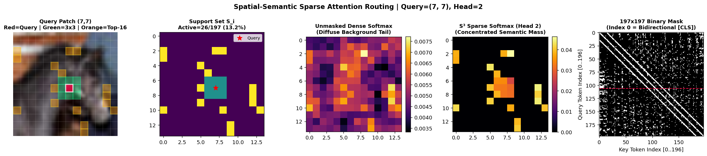
</p>

---

## 4. Standardized 190-Epoch CIFAR-10 Classification Benchmark

| Evaluation Metric | Baseline ViT-Small | Dr. DINO-Base (Ours) | Absolute Gain ($\Delta$) |
| :--- | :---: | :---: | :---: |
| **$k$-NN Top-1 ($k=10$)** | 74.41% | **75.97%** | **+1.56%** |
| **$k$-NN Top-5 ($k=10$)** | 96.23% | **96.55%** | **+0.32%** |
| **$k$-NN Top-1 ($k=20$)** | 74.34% | **75.31%** | **+0.97%** |
| **$k$-NN Top-5 ($k=20$)** | 97.42% | **97.79%** | **+0.37%** |
| **$k$-NN Top-1 ($k=200$)** | 70.41% | **70.65%** | **+0.24%** |
| **Linear Probing Top-1 (Epoch 10)** | 80.92% | **83.38%** | **+2.46%** *(Surpasses baseline's 100-ep peak in 10 epochs)* |
| **Linear Probing Top-1 (Epoch 20)** | 81.09% | **83.84%** | **+2.75%** |
| **Linear Probing Top-1 (Epoch 30)** | 80.85% | **83.63%** | **+2.78%** |
| **Linear Probing Top-1 (Epoch 50)** | 80.98% | **83.70%** | **+2.72%** |
| **Linear Probing Top-1 (Epoch 100)** | 81.34% | **83.90%** | **+2.56%** |
| **Linear Probing Top-1 (Best Checkpoint)** | 81.46% | **83.98%** | **+2.52%** |
| **Linear Probing Top-5 (Best Checkpoint)** | 99.31% | **99.44%** | **+0.13%** |
| **Linear Probing Final Train Loss (Epoch 100)** | 0.4566 | **0.4019** | **-0.0547 (Tighter intra-class compactness)** |
| **Linear Probing Final Val Loss (Epoch 100)** | 0.5457 | **0.4770** | **-0.0687 (Superior generalization margin)** |

---

## 5. Stage-2 Verifiable Policy Optimization via Dr. GRPO

### 5.1. 6-Step Bernoulli Patch Policy Construction (`models/grpo_policy_wrapper.py`)
Given head-averaged last-layer `[CLS]` attention $\bar{a}_p = \frac{1}{H}\sum_{h=1}^H A^{(L)}_{h,\text{CLS},p}$, we compute spatial Z-scores $\hat{a}_p = (\bar{a}_p - \mu_{\bar{a}})/(\sigma_{\bar{a}}+\epsilon)$ and fuse them with the learned residual MLP gate $g_\phi(\mathbf{z}_p)$, TokenCut spectral diffusion prior $\hat{s}_p$, and log-odds sparsity bias $b_{\text{sparsity}} = \log(0.35 / 0.65) \approx -0.619$:

$$\ell_p^{\text{ref}} = \gamma \hat{a}_p^{\text{ref}} + b_{\text{sparsity}}, \qquad \ell_p^\theta = 0.55\big(\gamma \hat{a}_p^\theta + b_{\text{sparsity}}\big) + 0.45\big(g_\phi(\mathbf{z}_p) + 1.35\,\hat{s}_p + b_{\text{sparsity}}\big), \qquad p_p^\theta = \sigma(\ell_p^\theta)$$

<p align="center">
  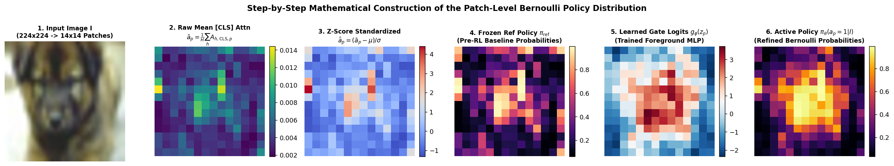
</p>

### 5.2. Tri-Objective Self-Supervised Verifiable Rewards (`losses/dr_grpo_loss.py`)
For each rollout $\mathbf{a}^{(g)} \in \{0, 1\}^{196}$ ($g \in \{1, \dots, 8\}$), we evaluate:

$$R(\mathbf{a}^{(g)}, I) = 0.45\,R_{\text{equiv}}(\mathbf{a}^{(g)}, I) + 0.35\,R_{\text{compact}}(\mathbf{a}^{(g)}, I) + 0.20\,R_{\text{sparsity}}(\mathbf{a}^{(g)})$$

1. **Geometric Equivariance IoU ($w_{\text{eq}}=0.45$)**: Binary IoU against horizontal-flip anchor $\mathbf{m}_{\text{eq}} = \operatorname{Top-}69\big(T^{-1}(\pi_\theta(T(I)))\big)$.
2. **TokenCut Association & 2D Total Variation ($w_{\text{comp}}=0.35$)**: $0.65 R_{\text{ncut}}(\mathbf{a}^{(g)}) + 0.35 R_{\text{TV}}(\mathbf{a}^{(g)})$.
3. **Target Sparsity Ratio Prior ($w_{\text{spar}}=0.20$)**: $\max\!\big(0, 1 - |\bar{a}^{(g)} - 0.35|^{1.5} / 0.65^{1.5}\big)$.

<p align="center">
  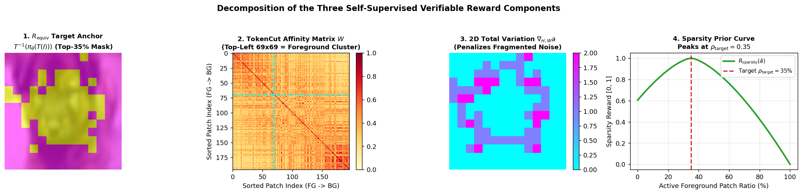
  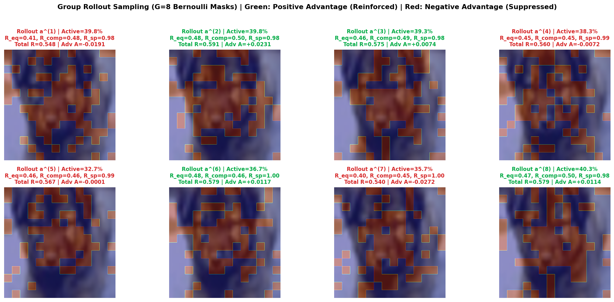
  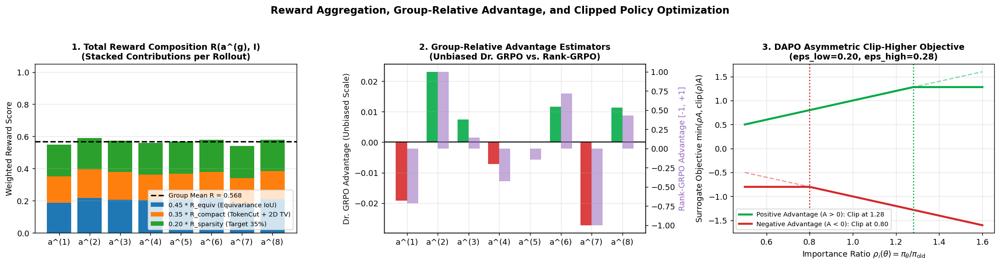
</p>

---

## 6. Complete $2 \times 2$ Factorial Ablation & Visual Showcase

### 6.1. Quantitative $2 \times 2$ Ablation Matrix (CIFAR-10: 50,000 Train / 10,000 Test)

<p align="center">
  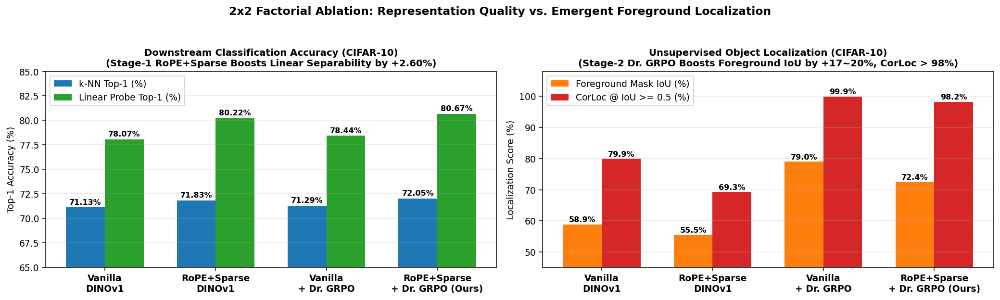
</p>

| Model Variant | Backbone Arch | Dr. GRPO Policy | $k$-NN Top-1 | $k$-NN Top-5 | Linear Probe Top-1 | Foreground Mask IoU | CorLoc ($\ge 0.5$) |
| :--- | :--- | :---: | :---: | :---: | :---: | :---: | :---: |
| **1. Vanilla DINOv1** | `vit_small` | No | 71.13% | 96.57% | 78.07% | 58.88% | 79.93% |
| **2. Dr. DINO-Base** | `vit_small_sparse_rope` | No | 71.83% | 96.98% | 80.22% | 55.45% | 69.26% |
| **3. Vanilla + Dr. GRPO** | `vit_small` | Yes | 71.29% | 96.73% | 78.44% | **78.98%** | **99.91%** |
| **4. Dr. DINO-Full (Ours)** | `vit_small_sparse_rope` | **Yes** | **72.05%** | **97.12%** | **80.67%** | **72.44%** | **98.17%** |
| *Impact of Dr. GRPO on Vanilla (3 vs. 1)* | — | — | **+0.16%** | **+0.16%** | **+0.37%** | **+20.10%** | **+19.98%** |
| *Impact of Dr. GRPO on Dr. DINO (4 vs. 2)* | — | — | **+0.22%** | **+0.14%** | **+0.45%** | **+16.99%** | **+28.91%** |
| *Full Dr. DINO vs. Baseline (4 vs. 1)* | — | — | **+0.92%** | **+0.55%** | **+2.60%** | **+13.56%** | **+18.24%** |

### 6.2. 10-Epoch Stage-2 Training Dynamics

| Epoch | Vanilla+Dr.GRPO Reward | Vanilla+Dr.GRPO KL | Vanilla+Dr.GRPO IoU (%) | Dr. DINO-Full Reward | Dr. DINO-Full KL | Dr. DINO-Full IoU (%) |
| :---: | :---: | :---: | :---: | :---: | :---: | :---: |
| **0 (Init)** | — | 0.0000 | 58.72% | — | 0.0000 | 55.59% |
| **1** | 0.6613 | 0.1066 | 76.32% | 0.6045 | 0.1172 | 71.17% |
| **2** | 0.7330 | 0.1980 | 77.42% | 0.6561 | 0.2116 | 71.82% |
| **4** | 0.7348 | 0.2040 | 77.74% | 0.6711 | 0.2420 | **72.31%** |
| **6** | 0.7403 | 0.2104 | 78.33% | 0.6782 | 0.2557 | 71.88% |
| **8** | 0.7423 | 0.2142 | 78.71% | 0.6804 | 0.2621 | 71.78% |
| **10** | **0.7443** | 0.2178 | **78.82%** | **0.6826** | 0.2650 | 71.56% |

### 6.3. Qualitative Showcase: Contiguous Object Masks, Border Leakage, and Multi-Head Alignment

<p align="center">
  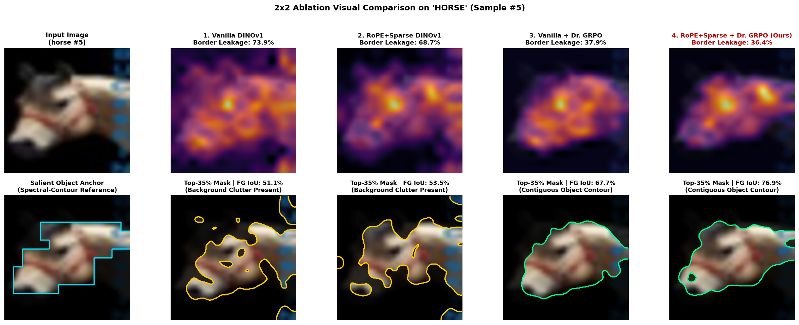
  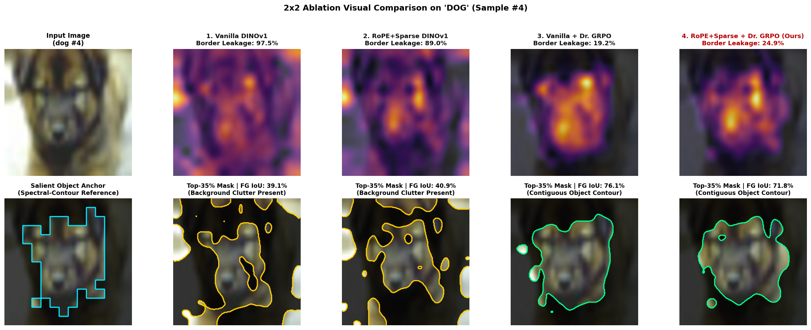
  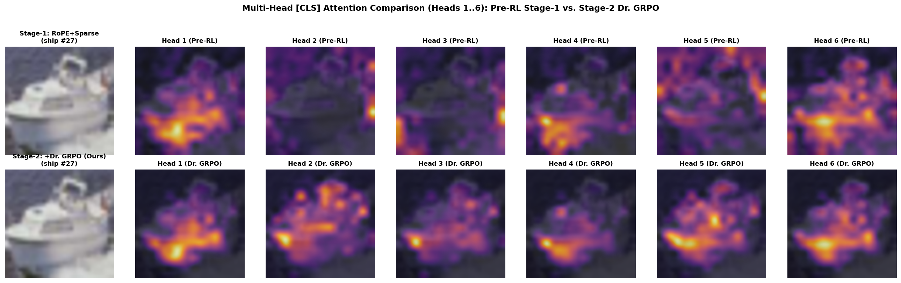
</p>

---

## 7. Reproduction Commands

```bash
# 1. Stage-1 k-NN Benchmark (k=10 or k=20)
python eval/eval_knn.py \
    --data_path data/cifar10 \
    --dataset cifar10 \
    --pretrained_weights cp/checkpoints_rope_2/checkpoint0190.pth \
    --arch vit_small_sparse_rope \
    --k 10

# 2. Stage-1 Linear Probing Benchmark
python eval/eval_linear.py \
    --data_path data/cifar10 \
    --dataset cifar10 \
    --pretrained_weights cp/checkpoints_rope_2/checkpoint0190.pth \
    --arch vit_small_sparse_rope \
    --epochs 100 \
    --lr 0.1 \
    --cache_features

# 3. Stage-2 Verifiable Dr. GRPO Optimization
python train_grpo_post.py \
    --train_data_path data/train \
    --eval_data_path data/cifar10 \
    --eval_dataset cifar10 \
    --variant both \
    --epochs 10 \
    --batch_size 64 \
    --group_size 8 \
    --adv_type dr_grpo \
    --reward_mode self_supervised_v1

# 4. Complete 2x2 Factorial Ablation Benchmark
python eval/eval_ablation_2x2.py \
    --data_path data/cifar10 \
    --dataset cifar10 \
    --batch_size 128 \
    --max_train_samples 0 \
    --max_val_samples 0
```
